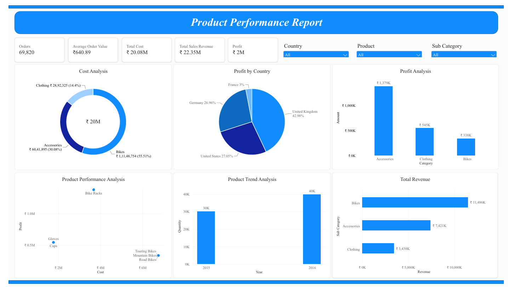

# 📊 Product Performance Dashboard (Power BI)

## 📌 Project Overview
An interactive end-to-end **Power BI Business Intelligence dashboard** designed to evaluate global revenue, cost structures, order volume, and profit margins across countries and product categories.

## 🎯 Business Objectives
* Track overall financial health across key KPIs: **Orders (69,820), Average Order Value (₹640.89), Total Cost (₹20.08M), Total Sales Revenue (₹22.35M), and Profit (₹2M)**.
* Identify top-performing **countries** and **product categories** driving revenue and net margin.
* Uncover high-cost areas to support data-driven pricing and profitability decisions.

## 🛠️ Tools & Skills Used
* **Power BI Desktop:** Data modeling, DAX measures, interactive slicers (*Country, Product, Sub Category*), and custom visual formatting.
* **Data Cleaning & Transformation:** Power Query Editor.
* **Business & Financial Analysis:** Revenue vs. cost variance and profit margin evaluation.

## 📈 Key Insights
* **Regional Performance:** Highlighted top profit-generating countries alongside regional margin differences.
* **Category Profitability:** Compared total sales volume against net profit across product lines (*Accessories, Bikes, Clothing*) to spot high-margin vs. high-cost categories.
* **Interactive Filtering:** Enabled dynamic cross-filtering by country, product, and sub-category for executive-level exploration.

## 📂 Repository Contents
* [`SalesDashboard.pbix`](SalesDashboard.pbix) — Complete interactive Power BI report file.
* [`SalesDashboard.pdf`](SalesDashboard.pdf) — Exported PDF report for quick viewing.
* [`Sales-DashBoard.png`](Sales-DashBoard.png) — High-resolution dashboard preview.
